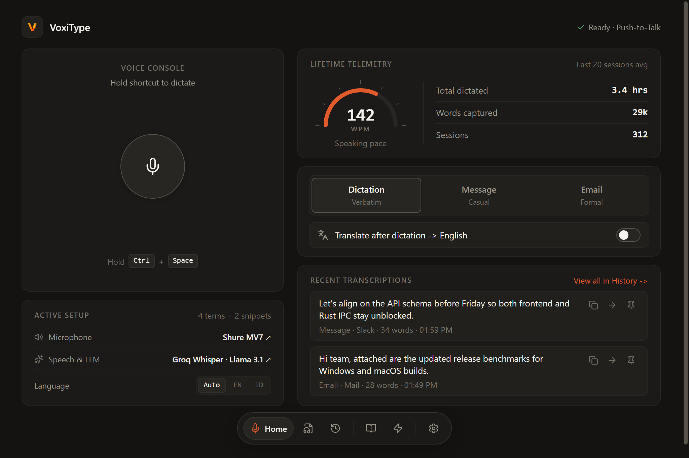
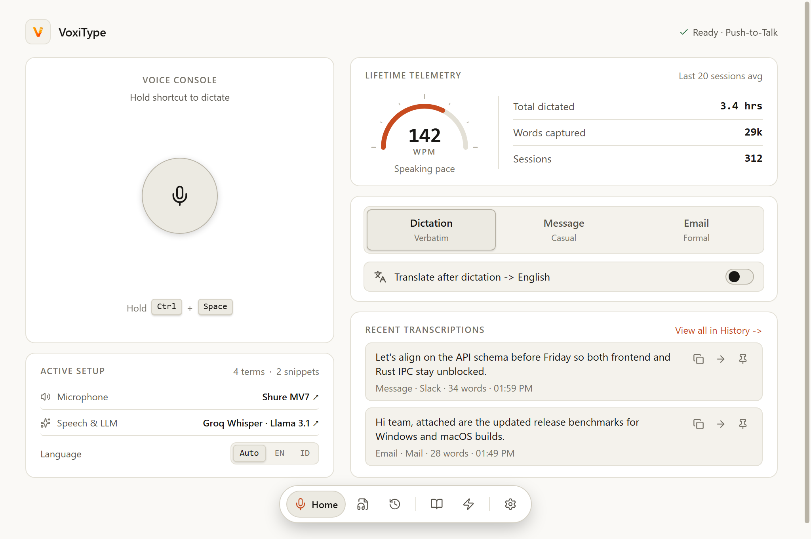
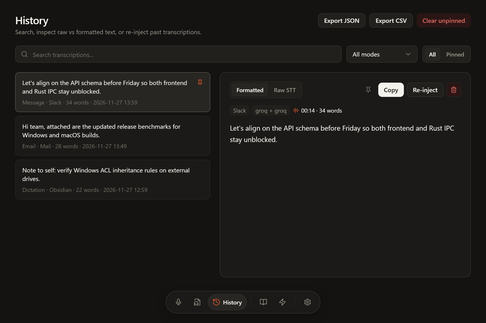
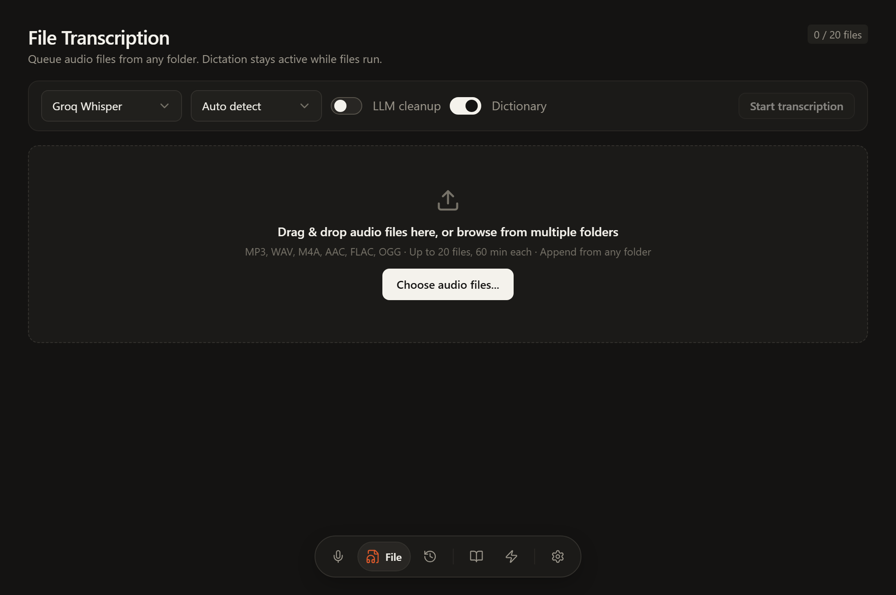
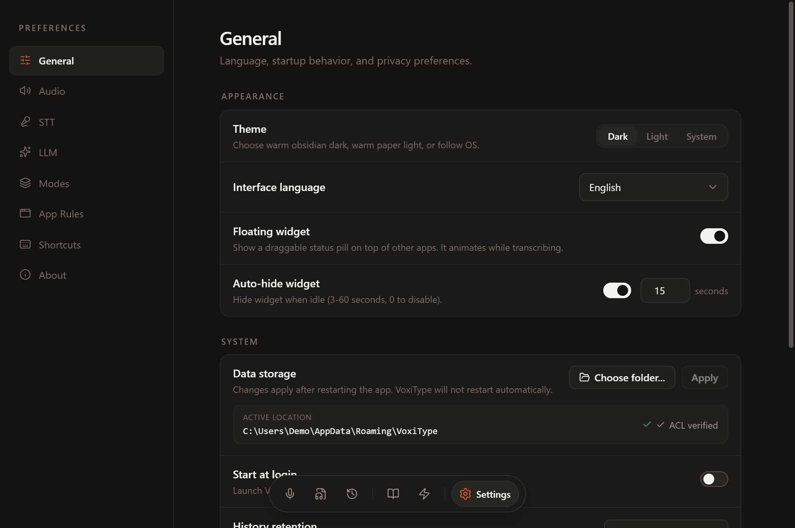

<p align="center">
  
</p>

# VoxiType

**Version 0.8.0** - Open-source voice-to-text for every app.

VoxiType is a desktop voice dictation application for Windows, macOS, and Linux. Press a global hotkey, speak, and VoxiType transcribes with Groq Whisper or local whisper.cpp, optionally formats the result with an LLM, then inserts the final text into the active application. It also transcribes audio files in batches and exports each transcript as TXT, Word, or PDF.



## Platform Support

| Platform | Status |
|----------|--------|
| Windows 10/11 | Fully supported, verified in CI |
| macOS 11+ | Supported (Apple Silicon and Intel), ad-hoc signed |
| Linux (X11) | Supported via AppImage or deb (x86_64) |

Releases are unsigned. Windows users will see a SmartScreen warning on first install. macOS builds are ad-hoc signed, so the first launch needs the steps below.

## Features

- **Responsive Desktop Workspace** - Split Voice Console and Active Setup layout with 1-click dictation language switching (`Auto`, `EN`, `ID`), calibrated WPM telemetry, mode selector, and sliding Floating Dock, adapting cleanly from compact `680x520` windows to wide screens
- **Dark, Light, and System Themes** - Warm Obsidian Dark and Warm Paper Light surfaces synchronized across the main window and floating overlay widget
- **Speech-to-Text Anywhere** - Dictate into any active desktop application
- **File Transcription** - Queue up to 20 audio files from multiple folders via native picker or drag-and-drop (MP3, WAV, M4A, AAC, FLAC, OGG; 60 minutes each) with per-file progress, partial-result recovery, and concurrent dictation support
- **Transcript Export** - Save one TXT, Word (DOCX), or PDF file per audio file; existing files are never overwritten
- **Cloud Transcription** - Groq Whisper API (whisper-large-v3-turbo)
- **Offline Transcription** - Local whisper.cpp with GGML models (see [docs/offline-whisper-cpp.md](docs/offline-whisper-cpp.md))
- **AI-Powered Formatting** - Off/pass-through, rule-based cleanup, local Ollama (Qwen2.5 3B) with local connection check, or Groq cloud (Llama 3.1 8B)
- **History & Editorial Reader** - Two-column split view with FTS5 search, mode filter, All/Pinned toggle, Formatted vs Raw STT tabs, JSON/CSV export, and configurable retention (30, 90, 180 days, or Forever)
- **Global Hotkey** - Start and stop recording from any application
- **Smart Text Injection** - Keystroke injection, clipboard paste, or hybrid mode via enigo + arboard
- **Floating Overlay Widget** - Always-on-top compact morphing pill (`92x34` idle) with waveform animation, draggable placement, capsule auto-hide, and animated reveal
- **Voice Command Mode** - Speak commands like "new line", "select all", "save" - executed as keystrokes
- **Per-App Formatting Modes** - Format mode automatically switches based on active application (Windows API detection) with a running-apps picker and 3-second target capture countdown
- **Dictionary Hotword Boosting** - Custom dictionary with word-bounded replacement, search, All/Active/Replacements filter chips, inline editing, and JSON import/export
- **Snippet Expansion** - Trigger phrase expansion with search, inline editing, and per-snippet active toggles
- **Translation Pipeline** - Automatic LLM-based translation to target language
- **Configurable Transcription Language** - Set transcription language via `stt_language` setting (Whisper-backed)
- **Encrypted API Key Storage** - API keys encrypted with AES-256-GCM at rest
- **First-Run Onboarding** - Guided 8-step setup for Groq or offline whisper.cpp, with a live microphone level meter, data directory selection (with resume across restarts), hotkey, and smoke test
- **Sound Cues** - Optional audio feedback when starting/stopping recording
- **Usage Stats** - Local lifetime totals and opt-in telemetry, never sent anywhere
- **Configurable Data Directory** - Choose storage location with validated migration (DB + master key + logs) and Windows ACL enforcement
- **Update Checker** - New version notification via GitHub Releases API

## Screenshots

<table>
  <tr>
    <td></td>
    <td></td>
  </tr>
  <tr>
    <td align="center"><sub>Home (Warm Paper Light)</sub></td>
    <td align="center"><sub>History Split Editorial Reader</sub></td>
  </tr>
  <tr>
    <td></td>
    <td></td>
  </tr>
  <tr>
    <td align="center"><sub>File Transcription</sub></td>
    <td align="center"><sub>Settings (8 Tabs & Theme Controls)</sub></td>
  </tr>
</table>

## Tech Stack

| Layer | Technology |
|-------|-----------|
| Desktop | Tauri 2.x |
| Frontend | React 19 + Vite 7 + Tailwind 4 |
| State | Zustand 5.x |
| Backend | Rust 1.90+ |
| Storage | SQLite (rusqlite) |
| Audio | cpal + rubato; symphonia for file decode |
| Export | TXT, DOCX (zip), PDF (built-in Helvetica) |
| STT | Groq Whisper API + whisper.cpp (selectable via `stt_engine` setting) |
| LLM | Ollama (Qwen2.5 3B), Groq (Llama 3.1 8B), rule-based, off |
| Text Injection | enigo (keystroke) + arboard (clipboard) |
| Crypto | AES-256-GCM (aes-gcm + base64) |
| Hotkey | Tauri global-shortcut plugin |

## Requirements

- Windows 10/11, macOS 11+, or Linux (X11)
- Node.js 20+
- Rust 1.90+
- Groq API key for cloud transcription ([sign up for free](https://console.groq.com/))
- Optional for offline mode: whisper-cli binary + GGML model

## Getting Started

### Download Pre-built Binaries

Download the latest installer from the [Releases page](https://github.com/TrygerZ/VoxiType/releases). Choose Groq for cloud transcription or configure offline whisper.cpp during first-run setup.

### macOS

1. Open the `.dmg` and drag VoxiType to Applications.
2. Launch it with right-click > Open the first time. If macOS reports the app is damaged, run `xattr -cr /Applications/VoxiType.app` and try again.
3. Grant Accessibility permission on first dictation. macOS shows its prompt, and VoxiType reports the failure if the permission is still missing. Enable VoxiType under System Settings, Privacy and Security, Accessibility.

### Linux

Portable, no installation:

```bash
chmod +x VoxiType_*.AppImage
./VoxiType_*.AppImage
```

Debian package, installed system-wide with an app menu entry and uninstall via the package manager:

```bash
sudo apt install ./VoxiType_*.deb
```

Use `apt install ./file.deb` rather than `dpkg -i`: only `apt` resolves the dependencies listed in the package.

The tray needs an appindicator host; GNOME requires the AppIndicator extension. VoxiType requires an X11 session: on Wayland the global hotkey and text injection are unavailable, and the app shows a notice instead of working. Native Wayland clients cannot be dictated into yet.

### Build from Source

#### Development

```bash
# Install frontend dependencies
npm install

# Run development server
npm run tauri dev
```

Set your Groq API key in Settings → STT to start using transcription.

For offline dictation without Groq, follow [docs/offline-whisper-cpp.md](docs/offline-whisper-cpp.md).

#### Commands

| Task | Command |
|------|---------|
| Dev server | `npm run tauri dev` |
| Build app | `npm run tauri build` |
| Rust tests | `cargo test --no-default-features` (in `src-tauri/`) |
| Rust lint | `cargo clippy --no-default-features -- -D warnings` (in `src-tauri/`) |
| TypeScript check | `npx tsc --noEmit` |
| Frontend build | `npm run build` |
| Frontend tests | `npm run test` |
| Rust build check | `cargo check` (in `src-tauri/`) |

## Architecture

VoxiType enforces strict separation of concerns:

- **Modules = traits + factories** - Each module (STT, LLM, Text Injection) is a trait with factory instantiation; audio is a concrete implementation
- **Pipeline orchestrates** - `pipeline/` controls the entire recording lifecycle as a finite state machine. Modules do not call each other
- **IPC only** - Frontend communicates via `invoke`/events, never touches system APIs
- **Storage isolated** - Only `storage/` module accesses SQLite
- **Module error types** - Unified `AppError` with typed `ErrorCode` across all modules

### State Machine

```
Idle → Recording → Processing → Idle (success)
 ↑                               ↓
 '-------- Error ←---------------'
```

Error→Recording retry for transient failures (network, timeout) with exponential backoff (3 retries, 1s base delay). Permanent errors (missing API key, engine unavailable) transition to Error state, requiring user action. All state changes emit Tauri events to frontend.

### Data Flow

```
User presses hotkey
       │
[Idle → Recording]  - Audio capture via cpal, resample 48k → 16k into the capture buffer
        │ (hotkey release / toggle stop)
[Recording → Processing]
       ├── STT: Groq Whisper API or local whisper.cpp (with hotword boosting)
       ├── LLM: Off/pass-through, rule-based cleanup, Ollama, or Groq with fallback chain
       ├── Translation: Optional, translate to target language
       ├── Post-Process: Dictionary replacements → Snippet expansion
       │
[Processing → Idle]  - Inject text into active application + save to history
```

### IPC Surface

VoxiType exposes **57 Tauri commands** organized into 9 modules:

| Module | Commands |
|--------|----------|
| `recording` | `start_recording`, `stop_recording` |
| `settings` | `get_settings`, `update_setting`, `set_floating_widget_enabled` |
| `history` | `get_history`, `search_history`, `delete_history`, `pin_history`, `clear_history`, `re_inject`, `export_history` |
| `dictionary` | `get_dictionary`, `add_dictionary_word`, `update_dictionary_word`, `set_dictionary_active`, `delete_dictionary_word`, `export_dictionary`, `import_dictionary` |
| `snippets` | `get_snippets`, `add_snippet`, `set_snippet_active`, `delete_snippet` |
| `per_app` | `get_per_app_modes`, `set_per_app_mode`, `delete_per_app_mode`, `get_active_app`, `list_running_apps` |
| `misc` | `get_microphones`, `set_hotkey`, `get_app_info`, `check_updates`, `open_url`, `reveal_floating_widget`, `reset_widget_idle_timer`, `ack_widget_hide`, `ack_widget_reveal`, `pick_setup_file`, `set_whisper_cpp_paths`, `pick_data_directory`, `set_data_directory`, `restrict_data_directory`, `get_data_directory`, `restart_app`, `test_groq_api`, `test_ollama`, `test_whisper_cpp`, `set_mic_meter` |
| `stats` | `get_usage_stats` |
| `file_transcription` | `pick_audio_files`, `register_dropped_audio_files`, `remove_queued_audio_file`, `clear_queued_audio_files`, `transcribe_file`, `cancel_file_transcription`, `pick_export_directory`, `export_transcripts` |

### Events (Backend -> Frontend)

| Event | Payload | Description |
|-------|---------|-------------|
| `state_changed` | `{ state: "idle"\|"recording"\|"processing"\|"error" }` | Pipeline state transition |
| `transcription_complete` | `{ id, text, word_count, duration_ms, injected, app_context }` | Successful transcription result; `injected` is false when the text never reached the focused app |
| `transcription_error` | `{ message, code }` | Transcription failure |
| `audio_level` | `{ level: f32 }` | Real-time microphone input level (0.0 to 1.0) |
| `floating_widget_hide_requested` | `{ id }` | Overlay requests animated hide before window hide |
| `floating_widget_reveal_requested` | `{ id }` | Overlay requests animated reveal after window show |
| `navigate` | `string` | System tray route navigation request for main window |
| `file_transcription_progress` | `{ stage: "transcribing"\|"formatting", done, total }` | File job progress; `total` is 0 when the file reports no duration |
| `notice` | `{ code, message }` | User-visible notice; `code` identifies the notice and `message` provides fallback text |
| `theme_changed` | `{ theme }` | Synchronized theme preference broadcast to secondary windows |

## Project Structure

```
src/                  # React frontend
├── components/
│   ├── common/          # FloatingDock, HomeView, PanelHeader, WpmHalfRing
│   ├── dictionary/      # DictionaryPanel, SnippetsPanel
│   ├── file-transcription/ # FileTranscriptionPanel + FileQueueItem (batch queue, drag-drop, export)
│   ├── floating-widget/ # FloatingWidget + Waveform (compact morphing pill overlay)
│   ├── history/         # HistoryPanel (split editorial reader, search, pin, export, re-inject)
│   ├── onboarding/      # OnboardingFlow (first-run setup: 8 steps)
│   ├── settings/        # SettingsLayout, SettingsPanel + 8 tabs (General, Audio, STT, LLM, Modes, App Rules, Shortcuts, About)
│   ├── ui/              # Button, IconButton, Input, Keycap, Select, StatusBadge, Switch, Toast, AclRestrictPrompt
│   └── ErrorBoundary.tsx # Top-level React error boundary
├── hooks/               # useTauriEvents (backend event subscriptions)
├── lib/                 # tauri.ts (typed invoke/listen), i18n.ts (EN/ID), theme.ts
├── stores/              # Zustand: appStore, settingsStore, historyStore, dictionaryStore, snippetStore, statsStore, fileTranscriptionStore, toastStore
├── styles/              # index.css (Tailwind 4, Warm Obsidian Dark & Warm Paper Light matte tokens, motion)
└── types/               # app.ts, events.ts

src-tauri/src/        # Rust backend
├── active_window.rs  # Per-app mode detection via Win32 API
├── audio/            # Audio capture (cpal) + resampler (rubato) + file decode (symphonia)
├── commands/         # Tauri IPC handlers (57 commands across 9 modules + runtime helpers)
├── crypto.rs         # AES-256-GCM API key encryption
├── data_dir.rs       # Data directory marker resolution, validation, copy-on-migrate
├── data_dir_acl.rs   # Windows ACL validation and one-click restriction for custom data directories
├── error.rs          # Unified AppError + typed ErrorCode
├── events.rs         # Tauri event emitters (state_changed, audio_level, theme_changed, etc.)
├── export.rs         # Transcript export writers (TXT, DOCX, PDF)
├── hotkey/           # Global hotkey registration + rebind
├── injection/        # Text injection (keystroke, clipboard, hybrid, command mode)
├── llm/              # LLM formatting (Ollama, Groq, rule-based, fallback chain)
├── logging.rs        # tracing to stderr + daily files (14-file retention, attached after data directory resolution)
├── main.rs           # Tauri entry point
├── overlay.rs        # Floating widget window control + position persistence
├── pipeline/         # State machine orchestrator + batch processing + file transcription job
├── sound.rs          # Optional recording sound cues (start/stop tones)
├── storage/          # SQLite database
│   ├── db.rs         # Database open + migrations + pre-migration backup
│   ├── settings.rs   # SettingsManager (key-value JSON)
│   ├── history.rs    # HistoryRepository (CRUD + FTS5 search)
│   ├── dictionary.rs # DictionaryRepository (word-bounded replacements, hotword boosting)
│   ├── snippets.rs   # SnippetRepository (trigger expansion)
│   ├── per_app_modes.rs # PerAppModeRepository
│   └── stats.rs      # StatsRepository (local-date usage totals)
├── stt/              # Speech-to-text (Groq Whisper + whisper.cpp)
├── tray/             # System tray icon + context menu
├── updater.rs        # GitHub Releases version checker
└── util.rs           # Shared HTTP client, retry/backoff, and atomic file writes
```

## Configuration

Settings are stored as key-value pairs in SQLite, JSON-encoded. Key settings:

| Key | Type | Description |
|-----|------|-------------|
| `floating_widget` | bool | Show floating widget overlay |
| `mic_device` | string | Selected microphone device ID |
| `stt_language` | string | STT language code (e.g. "auto", "id", "en") |
| `stt_engine` | string | "groq" (default) or "whisper_cpp" |
| `groq_api_key` | string | Encrypted at rest via AES-256-GCM |
| `whisper_cpp_binary_path` | string | Path to whisper-cli executable |
| `whisper_cpp_model_path` | string | Path to GGML model file |
| `whisper_cpp_threads` | number | Thread count for whisper.cpp (default: 4) |
| `llm_engine` | string | "off", "ollama", "groq", "rule_based" |
| `llm_model` | string | Model name for selected engine |
| `active_mode` | string | "dictation", "message", "email", or custom |
| `translation_enabled` | bool | Enable LLM-based translation |
| `translation_target` | string | Target language code for translation |
| `command_mode` | bool | Enable voice command mode |
| `sound_cues` | bool | Play start/stop sounds |
| `telemetry` | bool | Opt-in local usage statistics |
| `per_app_mode` | bool | Enable per-app mode routing |
| `hotkey` | HotkeyConfig | Global hotkey key + modifiers |
| `floating_widget_auto_hide_seconds` | number | Idle seconds before the floating widget auto-hides (0 disables) |
| `floating_widget_pos` | object | Persisted floating widget screen position |
| `onboarding_completed` | bool | First-run onboarding completion flag |
| `onboarding_resume_step` | string | Persisted step ID to resume after data-directory restart during onboarding |
| `language` | string | UI language code ("en" or "id") |
| `theme` | string | Appearance theme ("dark", "light", or "system") |
| `history_retention_days` | number | Days to keep history entries (30, 90, 180, or 0 for forever) |
| `stt_model` | string | Model name for the selected STT engine |
| `auto_start` | bool | Launch VoxiType at sign-in (Windows Run key, macOS LaunchAgent, Linux XDG autostart) |
| `auto_update` | bool | Check for updates automatically |

Data directory selection uses a marker file (`data_dir.txt`) in the default app-data directory. On first use, migration copies the active previous directory's DB, `master.key`, and logs. DB and key copies use SHA-256 verification and atomic rename. Remote, removable, and UNC targets are rejected. Custom directories must not grant other local accounts read, write, or control access; rejected directories report the offending account. Legacy unencrypted `master.key` files are accepted only in the default directory. Log files retain 14 daily files under the active data directory. Selected directory takes effect after restart.

## Offline STT Setup

For full offline transcription without Groq, see [docs/offline-whisper-cpp.md](docs/offline-whisper-cpp.md).

## CI/CD

| Workflow | Trigger | Steps |
|----------|---------|-------|
| CI | Push/PR to `main` | Frontend (TypeScript check, Vite build, tests) and Rust matrix on Windows, macOS, and Ubuntu (format, clippy, test with `--no-default-features`) |
| Build Test | Manual `workflow_dispatch` | Cross-platform installer builds (Windows NSIS, macOS aarch64/x64 dmg, Linux AppImage and deb) |
| Release | Push tag `v*` | Unsigned Windows NSIS, ad-hoc signed macOS dmg, and Linux AppImage/deb uploaded to a GitHub Release draft |

## License

This project is licensed under the MIT License. See the [LICENSE](LICENSE) file for details.

## Acknowledgments

- Built with [Tauri](https://tauri.app/), [React](https://react.dev/), and [Rust](https://www.rust-lang.org/)
- STT powered by [Groq](https://groq.com/) (Whisper large-v3-turbo) and [whisper.cpp](https://github.com/ggml-org/whisper.cpp)
- LLM formatting by [Ollama](https://ollama.ai/) (Qwen2.5 3B) and [Groq](https://groq.com/) (Llama 3.1 8B)
- Audio capture by [cpal](https://github.com/RustAudio/cpal), resampling by [rubato](https://github.com/HDegroote/rubato)
- Icons by [Lucide](https://lucide.dev/)
